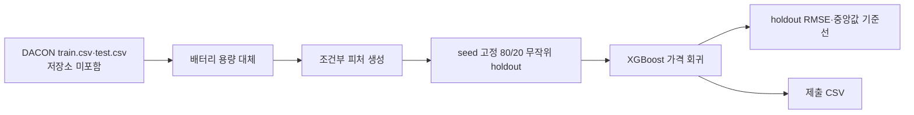

# 중고 전기차 가격 예측

제조사, 모델, 차량 상태, 주행거리, 보증 기간, 구동 방식, 배터리 용량으로 중고 전기차(EV) 가격(백만 원)을 예측하는 XGBoost 회귀 모델입니다. DACON 중고 전기차 가격 예측 해커톤(2024년 12월~2025년 1월)에 참가하며 만들었습니다.

**문제.** 전기차 가치에 직접 영향을 주는 배터리 용량이 학습 데이터의 36.2%(7,497행 중 2,711행), 테스트 데이터의 35.9%(846행 중 304행)에서 비어 있습니다. 평균 하나로 채우면 해당 차량이 모두 같은 배터리를 갖게 되므로, 가격 모델에 넣기 전에 별도 모델로 배터리 용량을 예측합니다.

**결과.** DACON 리더보드 점수 0.919(정규화 RMSE, 평균 제곱근 오차. 낮을수록 좋음).

**역할.** 이 저장소의 코드·분석·문서를 직접 작성했습니다.

**범위.** 리더보드 점수 하나이며, 노트북과 CLI 중 어느 쪽이 이 점수를 냈는지 알 수 없고 저장된 holdout 결과도 없습니다. DACON 데이터는 포함되어 있지 않으며, 데이터를 넣으면 `python src\ev_price_prediction_xgb.py --train-csv data\train.csv --test-csv data\test.csv`로 holdout RMSE와 중앙값 기준선 RMSE를 `results/metrics.json`에 기록할 수 있습니다.

[English](README.md) · [사례 연구](PORTFOLIO.ko.md) · [노트북](notebooks/EV_price_prediction_xgb.ipynb)

## 데이터

- 출처: [DACON 대회 데이터](https://dacon.io/competitions/official/236424/data)(`train.csv`, `test.csv`). 원본 파일은 재배포하지 않습니다.
- 학습 7,497행, 테스트 846행. 타깃은 `가격(백만원)`입니다.
- 배터리 용량(`배터리용량`)은 학습 4,786행, 테스트 542행에만 값이 있습니다.

## 접근 방식



- **배터리 대체를 별도 모델로.** 배터리 용량이 있는 행에서 제조사·모델·차량 상태·구동 방식·주행거리·보증 기간으로 용량을 학습하는 XGBoost 회귀 모델을 둡니다. CLI는 이 모델을 개발 분할에서만 학습하므로 검증 행의 정보가 들어가지 않습니다. 버린 대안: 평균·중앙값 하나로 채우기, 결측 행 삭제(데이터의 36%).
- **감가 피처.** 제조사×모델×차량 상태 조합, 연식 1년당 주행거리, 배터리 용량 1kWh당 주행거리, 중고 여부, 구동 방식 가중치, 사고 여부. 각 피처는 원천 컬럼이 있을 때만 만듭니다.
- **가격 모델.** 남은 수치 결측은 중앙값으로 채우고 범주는 one-hot 인코딩한 뒤 XGBoost 회귀 모델을 학습합니다.

코드 경로는 두 가지입니다. 대회 당시 노트북([`notebooks/EV_price_prediction_xgb.ipynb`](notebooks/EV_price_prediction_xgb.ipynb))은 학습 행 전체를 XGBoost 기본 설정으로 학습하고, 배터리 대체 모델을 테스트 행에 따로 학습하며, holdout이 없습니다. CLI([`src/ev_price_prediction_xgb.py`](src/ev_price_prediction_xgb.py))는 이후 리팩터링한 버전으로, 경로를 옮겨 쓸 수 있고 holdout과 자체 하이퍼파라미터가 있습니다.

## 결과

| 모델 | 지표 | 값 | 평가 조건 |
|---|---|---:|---|
| 배터리 대체 후 XGBoost 가격 모델 | 정규화 RMSE | 0.919 | DACON 리더보드 |

DACON 데이터를 넣고 CLI를 실행하면 80/20 holdout RMSE와 개발 분할 가격 중앙값 기준선이 `results/metrics.json`에 저장됩니다.

## 실행

```powershell
pip install -r requirements.txt
python scripts/smoke_test.py          # 합성 데이터 종단 점검, 데이터 불필요
python src\ev_price_prediction_xgb.py `
  --train-csv data\train.csv `
  --test-csv data\test.csv
```

DACON 파일을 `data/`에 두면 이 명령이 holdout RMSE를 출력하고 `results/metrics.json`(holdout RMSE, 중앙값 기준선 RMSE, 분할 방식, seed)을 쓴 뒤, 학습 데이터 전체로 다시 학습해 `results/submission.csv`를 만듭니다. `ev_pricing_pipeline.py`는 같은 인자를 받는 얇은 래퍼입니다. `scripts/smoke_test.py`는 임시 폴더의 작은 합성 CSV로 CLI를 실행해 `metrics.json`에 holdout RMSE와 중앙값 기준선 RMSE가 있는지 확인하며, 그 수치는 합성 데이터 값이지 결과가 아닙니다. `requirements.txt`는 2026-11 점검 환경(Python 3.13.2) 버전으로 고정했으며, 대회 노트북은 Python 3.12.4에서 실행했고 당시 패키지 버전은 기록되지 않았습니다.

## 한계

- 노트북과 CLI는 다르고(기본 대 지정 하이퍼파라미터, 테스트 행 대 학습 행 기반 대체 모델, holdout 없음 대 있음), 0.919가 어느 쪽에서 나왔는지는 알 수 없습니다.
- 검증은 seed를 고정한 무작위 holdout 한 번이며, 교차검증이나 시점·차종 기준 분할이 아닙니다. 처음 보는 차종에서의 성능은 확인하지 않았습니다.
- 단순 채움 대비 모델 기반 대체의 이득은 같은 분할에서 측정하지 않았습니다.
- 구동 방식 가중치(AWD 1.2, RWD 1.1, FWD 1.0, 각각 사륜·후륜·전륜 구동)는 학습한 값이 아니라 직접 정한 값입니다.

## 저장소 구성

```text
src/ev_price_prediction_xgb.py   CLI: 대체, 피처, holdout, 제출
src/config.py                    경로(EV_PRICE_* 환경 변수로 변경 가능), seed, 분할 비율
ev_pricing_pipeline.py           래퍼 진입점
scripts/smoke_test.py            CLI 합성 데이터 종단 점검
notebooks/                       출력이 저장된 대회 당시 노트북
data/data                        DACON 데이터 페이지 링크
```

## 문서

- [포트폴리오 사례 연구](PORTFOLIO.ko.md)

## 라이선스

오픈소스 라이선스 없음: 코드와 문서는 열람용으로 공개하며, 재사용하려면 허락이 필요합니다.
