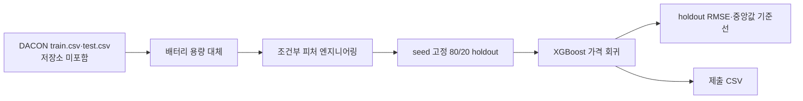

# XGBoost 기반 중고 전기차 가격 예측

[English](README.md) · [사례 연구](PORTFOLIO.ko.md)

제조사, 모델, 차량 상태, 주행거리, 보증 기간, 구동 방식, 배터리 용량으로 중고 전기차 가격(백만 원)을 예측합니다. DACON 중고 전기차 가격 예측 해커톤(2024년 12월~2025년 1월) 참가 프로젝트입니다.

**왜 중요한가:** 전기차 가치에 직접 영향을 주는 배터리 용량이 약 36%의 행에서 비어 있습니다(노트북에 저장된 출력 기준 학습 7,497행 중 2,711행, 테스트 846행 중 304행). 평균 하나로 채우면 결측 차량이 모두 같은 배터리를 가진 것처럼 처리되므로, 가격 모델에 넣기 전에 별도 모델로 배터리 용량을 예측했습니다.

**결과:** 사용자가 확인한 DACON 정규화 리더보드 RMSE **0.919**입니다. 제출 파일과 리더보드 캡처가 남아 있지 않아 이 저장소에서 점수를 다시 계산할 수 없으며, CLI가 저장하는 로컬 holdout RMSE는 다른 지표입니다.

## 데이터

- 출처: [DACON 대회 데이터](https://dacon.io/competitions/official/236424/data)(`train.csv`, `test.csv`). 원본 파일은 재배포하지 않습니다.
- 규모(노트북의 `info()` 출력 기준): 학습 7,497행, 테스트 846행. 타깃은 `가격(백만원)`입니다.
- 배터리 용량(`배터리용량`)은 학습 4,786행, 테스트 542행에서만 관측됩니다.

## 접근 방법



- **배터리 대체를 독립 모델로 분리.** 제조사, 모델, 차량 상태, 구동 방식, 주행거리, 보증 기간으로 배터리 용량을 예측하는 XGBoost 모델을 관측된 행만으로 학습합니다. CLI에서는 개발 분할에만 학습시켜 검증 행 정보가 섞이지 않습니다. 평균·중앙값 일괄 대체와 결측 행 삭제(데이터의 36%)는 채택하지 않았습니다.
- **감가 패턴 피처.** 제조사×모델×상태 조합, 연식당 주행거리, 배터리 용량 1kWh당 누적 주행거리, 중고 여부, 구동 방식 가중치, 사고 이력 플래그를 원본 컬럼이 있을 때만 만듭니다.
- **가격 모델.** 남은 수치 결측은 중앙값, 범주형은 one-hot encoding으로 처리한 뒤 XGBoost 회귀로 예측합니다.

코드 경로는 두 가지입니다. 노트북([`notebooks/EV_price_prediction_xgb.ipynb`](notebooks/EV_price_prediction_xgb.ipynb))은 대회 당시 흐름으로, 학습 데이터 전체에 기본 설정 XGBoost를 학습하고 테스트 행에는 별도의 배터리 대체 모델을 학습시키며 holdout이 없습니다. CLI([`src/ev_price_prediction_xgb.py`](src/ev_price_prediction_xgb.py))는 이후 정리한 버전으로, 이식 가능한 경로와 holdout, 별도의 하이퍼파라미터를 사용합니다. 0.919 제출이 정확히 어떤 설정에서 나왔는지는 기록되어 있지 않습니다.

## 결과

| 모델 | 지표 | 값 | 평가 조건 |
|---|---|---:|---|
| 배터리 대체 후 XGBoost 가격 모델 | DACON 정규화 RMSE | 0.919 | 대회 리더보드, 사용자 확인 |
| 개발 분할 가격 중앙값(기준선) | RMSE | - | CLI 80/20 holdout, `results/metrics.json`에 기록 |
| XGBoost 가격 모델(CLI) | RMSE | - | CLI 80/20 holdout, `results/metrics.json`에 기록 |

"-": DACON 데이터를 넣고 실행해야 계산되며, 저장소에 보관된 실행 결과는 없습니다.

## 결과가 말해 주는 것과 아닌 것

- 0.919는 작성자가 확인한 리더보드 점수이며 이 저장소로 재현할 수 있는 수치가 아닙니다. 데이터 버전, 제출 파일, 캡처가 남아 있지 않습니다.
- CLI 검증은 seed 고정 단일 무작위 holdout입니다. 교차 검증, 시간 기준 분할, 차종 기준 분할이 아니므로 처음 보는 차종에 대한 일반화는 확인하지 않았습니다.
- 모델 기반 대체가 단순 대체보다 나은지는 같은 분할에서 비교하지 않았고, 피처 중요도 산출물도 남아 있지 않습니다.
- 구동 방식 가중치(AWD 1.2, RWD 1.1, FWD 1.0)는 학습값이 아니라 직접 정한 값입니다.

## 실행

Python 3.13.2에서 진입점 컴파일과 `--help` 실행을 확인했습니다. 대회 데이터가 없어 전체 파이프라인은 여기서 실행하지 않았습니다.

```powershell
pip install -r requirements.txt
python src\ev_price_prediction_xgb.py --help
python src\ev_price_prediction_xgb.py `
  --train-csv data\train.csv `
  --test-csv data\test.csv
```

DACON 파일을 `data/`에 두면 마지막 명령이 holdout RMSE를 출력하고 `results/metrics.json`(holdout RMSE, 중앙값 기준선 RMSE, 분할 방식, seed)을 쓴 뒤, 학습 데이터 전체로 다시 학습해 `results/submission.csv`를 만듭니다. `ev_pricing_pipeline.py`는 같은 인자를 받는 얇은 래퍼입니다.

## 저장소 구조

```text
src/ev_price_prediction_xgb.py   CLI: 대체, 피처, holdout, 제출 파일
src/config.py                    경로(EV_PRICE_* 환경 변수로 변경 가능), seed, 분할 비율
ev_pricing_pipeline.py           래퍼 진입점
notebooks/                       출력이 저장된 대회 당시 노트북
data/data                        DACON 데이터 페이지 링크
docs/PROJECT_REVIEW.md           방법론 리뷰와 우선순위
```

## 문서

- [포트폴리오 사례 연구](PORTFOLIO.ko.md)
- [프로젝트 리뷰](docs/PROJECT_REVIEW.md)
