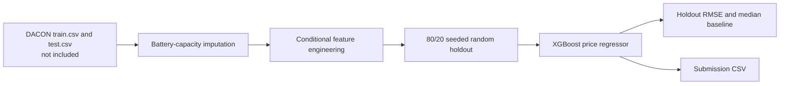

# Used-EV Price Forecasting with XGBoost

[한국어](README.ko.md) · [Case study](PORTFOLIO.md)

Predicts the resale price of used electric vehicles (KRW million) from make,
model, condition, mileage, warranty, drivetrain, and battery capacity. Built
for the DACON used-EV price hackathon (December 2024 to January 2025).

**Why it matters:** battery capacity, a direct driver of EV value, is missing
in about 36% of rows (2,711 of 7,497 training rows and 304 of 846 test rows in
the saved notebook output). Filling it with one average would give every
affected car the same battery, so the project predicts it with a separate
model before the price model sees it.

**Result:** user-confirmed DACON normalized leaderboard RMSE **0.919**. The
submitted file and leaderboard capture are not retained, so the score cannot be
recomputed from this repository, and the local holdout RMSE that the CLI writes
is a different metric.

## Data

- Source: [DACON competition data](https://dacon.io/competitions/official/236424/data)
  (`train.csv`, `test.csv`). The files are not redistributed here.
- Size, from the notebook's saved `info()` output: 7,497 training rows and 846
  test rows; target `가격(백만원)` (price in KRW million).
- Battery capacity (`배터리용량`) is observed in 4,786 training rows and 542
  test rows.

## Approach



- **Battery imputation as its own model.** An XGBoost regressor learns battery
  capacity from make, model, condition, drivetrain, mileage, and warranty, using
  only rows where capacity is observed. In the CLI it is fit on the development
  partition only, so validation rows do not inform it. The rejected
  alternatives were a single mean/median fill and dropping the rows (36% of the
  data).
- **Depreciation features.** Make x model x condition combinations, mileage per
  year of age, odometer km per kWh of capacity, a used flag, a drivetrain
  weight, and an accident flag. Each is created only when its source columns
  exist.
- **Price model.** Median imputation for remaining numeric gaps, one-hot
  encoding for categories, then an XGBoost regressor.

Two code paths exist. The notebook
([`notebooks/EV_price_prediction_xgb.ipynb`](notebooks/EV_price_prediction_xgb.ipynb))
is the competition-era workflow: it trains on all training rows with default
XGBoost settings, fits a separate battery imputer on the test rows, and has no
holdout. The CLI ([`src/ev_price_prediction_xgb.py`](src/ev_price_prediction_xgb.py))
is a later refactor with portable paths, a holdout, and its own
hyperparameters. Which exact configuration produced the 0.919 submission is not
recorded.

## Results

| Model | Metric | Value | Setting |
|---|---|---:|---|
| XGBoost price model after battery imputation | DACON normalized RMSE | 0.919 | Competition leaderboard, user-confirmed |
| Development-partition median price (baseline) | RMSE | - | CLI 80/20 holdout, written to `results/metrics.json` |
| XGBoost price model (CLI) | RMSE | - | CLI 80/20 holdout, written to `results/metrics.json` |

"-": computed only when the DACON data is supplied; no run output is retained
in this repository.

## What the result does and does not show

- 0.919 is a leaderboard score confirmed by the author, not a number this
  repository can reproduce. The data version, submission file, and capture are
  not retained.
- The CLI's validation is one seeded random holdout. It is not
  cross-validation, a time-based split, or a split by vehicle model, so
  generalisation to unseen models is untested.
- The benefit of model-based imputation over a simple fill was not measured
  under a shared split, and no feature-importance artifact is retained.
- The drivetrain weights (AWD 1.2, RWD 1.1, FWD 1.0) are hand-set, not learned.

## Run

Checked with Python 3.13.2: the entry points compile and `--help` runs. The
full pipeline was not run here because the competition data is not included.

```powershell
pip install -r requirements.txt
python src\ev_price_prediction_xgb.py --help
python src\ev_price_prediction_xgb.py `
  --train-csv data\train.csv `
  --test-csv data\test.csv
```

With the DACON files in `data/`, the last command prints the holdout RMSE,
writes `results/metrics.json` (holdout RMSE, median-baseline RMSE, split, seed),
then retrains on all training rows and writes `results/submission.csv`.
`ev_pricing_pipeline.py` is a thin wrapper with the same arguments.

## Repository layout

```text
src/ev_price_prediction_xgb.py   CLI: imputation, features, holdout, submission
src/config.py                    paths (overridable by EV_PRICE_* env vars), seed, split size
ev_pricing_pipeline.py           wrapper entry point
notebooks/                       competition-era notebook with saved outputs
data/data                        link to the DACON data page
docs/PROJECT_REVIEW.md           method review and priorities
```

## Documentation

- [Portfolio case study](PORTFOLIO.md)
- [Project review](docs/PROJECT_REVIEW.md)
