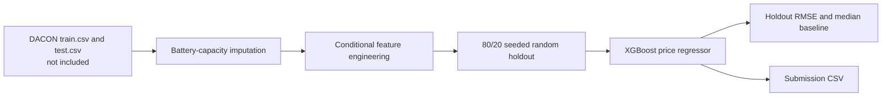

# Used-EV Price Prediction

XGBoost regressor that predicts the resale price of used electric vehicles
(EVs) in KRW million from make, model, condition, mileage, warranty,
drivetrain, and battery capacity, built for the DACON used-EV price hackathon
(December 2024 to January 2025).

**Problem.** Battery capacity, a direct driver of EV value, is missing in 36.2%
of training rows (2,711 of 7,497) and 35.9% of test rows (304 of 846). One
average would give every affected car the same battery, so a separate model
predicts capacity before the price model sees it.

**Result.** DACON leaderboard score 0.919 (normalized RMSE, root mean squared
error; lower is better).

**Scope.** One leaderboard score; whether the notebook or the CLI produced it
is unknown, and no holdout result is stored. DACON data not included; with it,
`python src\ev_price_prediction_xgb.py --train-csv data\train.csv --test-csv data\test.csv`
writes holdout and median-baseline RMSE to `results/metrics.json`.

[한국어](README.ko.md) · [Case study](PORTFOLIO.md) · [Notebook](notebooks/EV_price_prediction_xgb.ipynb)

## Data

- Source: [DACON competition data](https://dacon.io/competitions/official/236424/data)
  (`train.csv`, `test.csv`); not redistributed here.
- 7,497 training rows and 846 test rows; target `가격(백만원)` (price in KRW
  million).
- Battery capacity (`배터리용량`) is observed in 4,786 training rows and 542
  test rows.

## Approach



- **Battery imputation as its own model.** An XGBoost regressor learns battery
  capacity from make, model, condition, drivetrain, mileage, and warranty on
  rows where capacity is observed. The CLI fits it on the development partition
  only, so validation rows do not inform it. Rejected: a single mean/median
  fill, or dropping the rows (36% of the data).
- **Depreciation features.** Make x model x condition combinations, mileage per
  year of age, odometer km per kWh of capacity, a used flag, a drivetrain
  weight, and an accident flag, each created only when its source columns
  exist.
- **Price model.** Median imputation for remaining numeric gaps, one-hot
  encoding for categories, then an XGBoost regressor.

There are two code paths. The competition-era notebook
([`notebooks/EV_price_prediction_xgb.ipynb`](notebooks/EV_price_prediction_xgb.ipynb))
trains on all training rows with default XGBoost settings, fits a separate
battery imputer on the test rows, and has no holdout. The CLI
([`src/ev_price_prediction_xgb.py`](src/ev_price_prediction_xgb.py)) is a later
refactor with portable paths, a holdout, and its own hyperparameters.

## Results

| Model | Metric | Value | Setting |
|---|---|---:|---|
| XGBoost price model after battery imputation | Normalized RMSE | 0.919 | DACON leaderboard |

Running the CLI with the DACON data writes the 80/20 holdout RMSE and a
development-partition median-price baseline to `results/metrics.json`.

## How to run

```powershell
pip install -r requirements.txt
python src\ev_price_prediction_xgb.py `
  --train-csv data\train.csv `
  --test-csv data\test.csv
```

With the DACON files in `data/`, the command prints the holdout RMSE,
writes `results/metrics.json` (holdout RMSE, median-baseline RMSE, split, seed),
then retrains on all training rows and writes `results/submission.csv`.
`ev_pricing_pipeline.py` is a thin wrapper with the same arguments.

## Limitations

- The notebook and the CLI differ (default vs set hyperparameters, test-row vs training-row imputer, no holdout vs holdout), and it is not known which one produced 0.919.
- Validation is one seeded random holdout, not cross-validation or a split by time or vehicle model; generalization to unseen models is untested.
- The gain of model-based imputation over a simple fill was not measured under a shared split.
- Drivetrain weights (AWD 1.2, RWD 1.1, FWD 1.0 for all-, rear-, and front-wheel drive) are hand-set, not learned.

## Repository layout

```text
src/ev_price_prediction_xgb.py   CLI: imputation, features, holdout, submission
src/config.py                    paths (overridable by EV_PRICE_* env vars), seed, split size
ev_pricing_pipeline.py           wrapper entry point
notebooks/                       competition-era notebook with saved outputs
data/data                        link to the DACON data page
```

## Documentation

- [Portfolio case study](PORTFOLIO.md)
