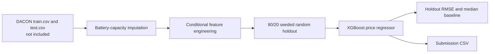

# Used-EV Price Forecasting with XGBoost

[한국어](README.ko.md) · [Case study](PORTFOLIO.md)

Predicts the resale price of used electric vehicles (EVs) in KRW million from
make, model, condition, mileage, warranty, drivetrain, and battery capacity.
Built for the DACON used-EV price hackathon (December 2024 to January 2025).

**Why it matters:** battery capacity, a direct driver of EV value, is missing
in about 36% of rows (2,711 of 7,497 training rows and 304 of 846 test rows).
One average would give every affected car the same battery, so a separate model
predicts capacity before the price model sees it.

**Result:** DACON leaderboard normalized RMSE (root mean squared error)
**0.919**.

## Data

- Source: [DACON competition data](https://dacon.io/competitions/official/236424/data)
  (`train.csv`, `test.csv`); not redistributed here.
- 7,497 training rows and 846 test rows (notebook `info()` output); target
  `가격(백만원)` (price in KRW million).
- Battery capacity (`배터리용량`) is observed in 4,786 training rows and 542
  test rows.

## Approach



- **Battery imputation as its own model.** An XGBoost regressor learns battery
  capacity from make, model, condition, drivetrain, mileage, and warranty on
  rows where capacity is observed. The CLI fits it on the development partition
  only, so validation rows do not inform it. Rejected: a single mean/median
  fill, or dropping the rows (36% of the data).
- **Depreciation features.** Make x model x condition combinations, mileage per
  year of age, odometer km per kWh of capacity, a used flag, a drivetrain
  weight, and an accident flag, each created only when its source columns
  exist.
- **Price model.** Median imputation for remaining numeric gaps, one-hot
  encoding for categories, then an XGBoost regressor.

Two code paths: the competition-era notebook
([`notebooks/EV_price_prediction_xgb.ipynb`](notebooks/EV_price_prediction_xgb.ipynb))
trains on all training rows with default XGBoost settings, fits a separate
battery imputer on the test rows, and has no holdout. The CLI
([`src/ev_price_prediction_xgb.py`](src/ev_price_prediction_xgb.py)) is a later
refactor with portable paths, a holdout, and its own hyperparameters.

## Results

| Model | Metric | Value | Setting |
|---|---|---:|---|
| XGBoost price model after battery imputation | DACON normalized RMSE | 0.919 | DACON leaderboard |
| Development-partition median price (baseline) | RMSE | - | CLI 80/20 holdout, written to `results/metrics.json` |
| XGBoost price model (CLI) | RMSE | - | CLI 80/20 holdout, written to `results/metrics.json` |

"-": computed when the DACON data is supplied.

## Run

Entry points compile and `--help` runs under Python 3.13.2.

```powershell
pip install -r requirements.txt
python src\ev_price_prediction_xgb.py --help
python src\ev_price_prediction_xgb.py `
  --train-csv data\train.csv `
  --test-csv data\test.csv
```

With the DACON files in `data/`, the last command prints the holdout RMSE,
writes `results/metrics.json` (holdout RMSE, median-baseline RMSE, split, seed),
then retrains on all training rows and writes `results/submission.csv`.
`ev_pricing_pipeline.py` is a thin wrapper with the same arguments.

## Limitations

- The leaderboard RMSE (0.919) and the CLI holdout RMSE are different metrics; the submission file and data version are not included, and which code path produced 0.919 is not recorded.
- No holdout RMSE output is included; it is produced when the DACON data is supplied.
- Validation is one seeded random holdout, not cross-validation or a split by time or vehicle model; generalisation to unseen models is untested.
- The gain of model-based imputation over a simple fill was not measured under a shared split; no feature-importance output is included.
- Drivetrain weights (AWD 1.2, RWD 1.1, FWD 1.0 for all-, rear-, and front-wheel drive) are hand-set, not learned.

## Repository layout

```text
src/ev_price_prediction_xgb.py   CLI: imputation, features, holdout, submission
src/config.py                    paths (overridable by EV_PRICE_* env vars), seed, split size
ev_pricing_pipeline.py           wrapper entry point
notebooks/                       competition-era notebook with saved outputs
data/data                        link to the DACON data page
docs/PROJECT_REVIEW.md           method review and priorities
```

## Documentation

- [Portfolio case study](PORTFOLIO.md)
- [Project review](docs/PROJECT_REVIEW.md)
